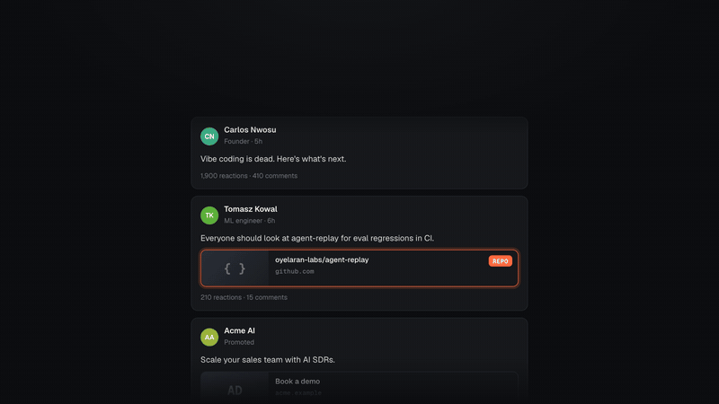

# Feedcast

Your LinkedIn feed, read for you. One page each evening.

<p align="center"></p>

Your feed carries real signal: new repos, papers and tools, often from people you don't follow. You're never on it long enough to catch them. Feedcast scrolls your feed in your own Chrome three times a day, keeps only what matches what you care about, and hands you one visual page at 19:30 with the repos, papers and articles people shared pulled out front.

- **Reads like a person.** Your own logged-in Chrome, a few minutes at a time, at human pace. It never clicks, likes, follows or comments. Any LinkedIn security check stops it and it waits for you.
- **Knows what you care about.** A short interest profile built from your local repos, your Claude Code session titles and your LinkedIn profile. You can edit every line.
- **One page, not a feed.** Topics, a top story, link previews, "shared by 3" when several people post the same repo, and everything it skipped one click away.
- **Local.** SQLite and a few files in `~/.feedcast`. No server, no account. Only your short interest profile and post text are sent to Claude.

## Get started

You need macOS, Google Chrome with the Claude in Chrome extension signed in to LinkedIn, [Claude Code](https://claude.com/claude-code) and [uv](https://docs.astral.sh/uv/).

```sh
uv tool install git+https://github.com/jcodebreaker/feedcast
feedcast setup
```

`feedcast setup` opens a page on your Mac where you:

1. Pick the folders with your code.
2. Read your LinkedIn profile once.
3. Check the interests it found, and add or remove any.
4. Press **Read now** to watch the first read, then **Turn on daily reads**.

That's it. Each evening a notification opens your page.

No Anthropic API key needed: without one, Feedcast runs its prompts through `claude -p` on your Claude plan. To use the API instead, set `ANTHROPIC_API_KEY`.

## How it works

| When | What happens |
|---|---|
| 02:00 | Refreshes your interest profile from your repos and sessions (names, READMEs, dependencies, commit titles; never your code). |
| 09:00 · 13:30 · 18:45 | Claude in Chrome scrolls your feed in a new tab for ~5 minutes and saves what it saw. Short links are followed without your LinkedIn cookies. Haiku scores each post against your interests and drops ads. |
| 19:30 | One Opus call writes the summary and groups. Counts, links and stars come from the local database, never from the model. Your page opens. |

Your **more like this / not relevant** buttons tune the next day's profile.

## Commands

| Command | Does |
|---|---|
| `feedcast setup` | Opens the setup page (folders, LinkedIn, interests, schedule, reads). |
| `feedcast capture --now` | Reads your feed once, right now. |
| `feedcast ingest` | Stores the latest read, resolves links, scores posts. |
| `feedcast report` | Builds and opens tonight's page. |
| `feedcast profile [--show \| --dry-run \| --linkedin]` | Rebuilds, shows or previews your interest profile. |
| `feedcast doctor` | Checks Chrome, Claude Code, the schedule and the last read. |
| `feedcast resume` | Starts reading again after a LinkedIn check paused it. |

## Before you use it

Automated reading of LinkedIn is against its User Agreement, whatever tool does it. Feedcast keeps to the lowest-risk shape it can: your own browser, a few short reads a day, read-only, and it stops on any check. Your account is the one at risk; decide for yourself.

## Develop

```sh
uv run python -m unittest discover -s tests   # offline, no LinkedIn, no API
uv run python scripts/demo.py                 # full pipeline on invented sample data
```

Design notes: [ARCHITECTURE.md](ARCHITECTURE.md) · data shapes: [CONTRACT.md](CONTRACT.md) · re-render the video: [docs/video](docs/video/README.md).

## License

MIT
